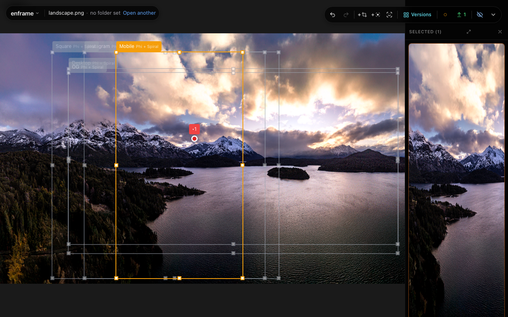
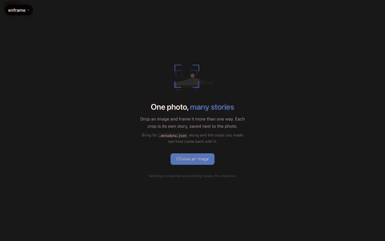
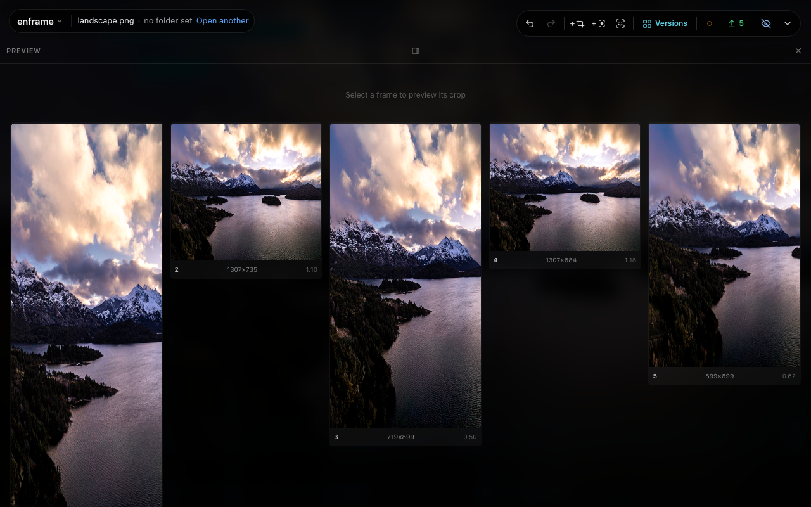

# Enframe

Set focal points once. Export one photo to every aspect ratio you need.

[](LICENSE)
[](https://github.com/mrgnw/enframe/commits/main/)
[](https://github.com/mrgnw/enframe/issues)
[](https://v2.tauri.app/)
[](https://svelte.dev/)
[](#quick-start-macos)



For photographers and designers preparing the same photo for a website, a phone wallpaper,
or social posts. Mark what matters, generate destination crops, adjust the framing, and
export the set. The desktop app works with local files and needs no account.

[Quick start](#quick-start-macos) · [Roadmap](ROADMAP.md) · [Changelog](CHANGELOG.md) · [Contribute](CONTRIBUTING.md)

> [!NOTE]
> Enframe was developed with substantial AI assistance. It is an experimental project;
> review the code and check exported results before relying on it. Bug reports and
> corrections to attribution are welcome.

## What it does

- **Frame around your subject.** Add shared or per-frame focal points, then move and resize crops by hand.
- **Generate five destinations.** Mobile 9:16, desktop 16:9, Instagram 4:5, Open Graph 1.91:1,
  and square. The fit engine warns when a destination cannot include every required point.
- **Preview before exporting.** Compare crops in a sidebar or the main window. Export all frames
  or only your selection as AVIF, JPG, or PNG, with a JSON sidecar for reopening the work.
- **Keep editing local.** Browse folders, watch an inbox, or read a local Lightroom library
  without writing to that library. Desktop decoding includes camera RAW and JPEG XL.
- **Work from the keyboard.** Undo and redo, generate versions with A, toggle previews with V,
  and open the command palette with ⌘K on macOS.
- **Go further.** Suggest focal points with local face detection, create carved versions in
  the library, or [stabilize a photo series](docs/stabilize/README.md) around a shared feature.

<details>
<summary>Watch the marking → generation → export flow (12 seconds)</summary>



</details>

The screenshots and recording show the real browser framer with a metadata-stripped landscape
from the repository. The desktop app uses the same framer with a native file picker and Rust exporter.

## Quick start (macOS)

There are no packaged releases yet. Build from source with [Git](https://git-scm.com/),
[Bun 1.2+](https://bun.sh/), [Node.js 22.12+](https://nodejs.org/), stable
[Rust](https://rustup.rs/), and the [Tauri macOS prerequisites](https://v2.tauri.app/start/prerequisites/#macos).
Rust must support edition 2024 (1.85 or newer). Install Xcode Command Line Tools if needed:

```sh
xcode-select --install
```

```sh
git clone https://github.com/mrgnw/enframe.git
cd enframe
bun install --frozen-lockfile
bun run sveltekit:build
bun run dev
```

The initial frontend build bootstraps the assets required by the Rust sidecar build.
Development uses port **5910**, with the local backend on **5911**. The first Rust build can take a while.
Drop an image on the start screen, click the subject, then choose **Versions**.

### Build and install

After the setup above:

```sh
bun run build
```

On macOS, the application and disk image are written under `src-tauri/target/release/bundle/`.
Open the disk image and drag Enframe to Applications. Builds are unsigned; no notarized installer
is published. Windows and Linux desktop builds are not verified here; see the
[Tauri platform prerequisites](https://v2.tauri.app/start/prerequisites/) before attempting them.

### Try just the framer in a browser

After cloning and installing JavaScript dependencies, this path needs no Rust build:

```sh
ENFRAME_TARGET=web bun run sveltekit:dev --host 0.0.0.0 --port 5918 --strictPort
```

Open http://localhost:5918. It edits one image at a time and exports through the browser.
The library, Lightroom integration, and Stabilize require the desktop or serve backend.
See [running modes](docs/running.md) for the headless server, static web build, and deployment notes.

## How it works

1. Open a photo directly, from a folder, or from a local Lightroom library.
2. Place focal points on what needs to stay visible.
3. Generate destination crops and review any fit warnings.
4. Adjust frames and compare the previews.
5. Export all or selected crops plus their sidecar; reopen the image with that sidecar to resume.



The interface uses Svelte 5 and SvelteKit; Tauri 2 and Rust provide the desktop shell,
image processing, and a SQLite-backed library. Crop coordinates are normalized to the source image.

## Contributing

Bug reports, small fixes, tests, and documentation improvements are welcome.
Read [CONTRIBUTING.md](CONTRIBUTING.md) for setup, checks, and the branch and pull request flow.
Start with [good first issues](https://github.com/mrgnw/enframe/issues?q=is%3Aissue%20is%3Aopen%20label%3A%22good%20first%20issue%22),
or discuss a larger change in an issue first. Planned work is in [ROADMAP.md](ROADMAP.md).

## License

Enframe's own code is licensed under [MIT](LICENSE). Dependencies retain their own licenses, including:

- [Tauri](https://github.com/tauri-apps/tauri): MIT or Apache-2.0, desktop shell.
- [Svelte](https://github.com/sveltejs/svelte): MIT, interface.
- [rawler](https://github.com/dnglab/dnglab/tree/main/rawler): LGPL-2.1, desktop and serve RAW decoding.
- [YuNet face detection](src-tauri/faces/NOTICE): MIT model and vendored detector;
  see the notice for upstream attribution and training-dataset terms.
- [libraw-wasm](https://github.com/ybouane/LibRaw-Wasm): ISC wrapper for the web build's RAW decoder.
  Its embedded [LibRaw](https://www.libraw.org/) is offered under LGPL-2.1 or CDDL-1.0;
  Enframe elects LGPL-2.1.

The web build emits replaceable decoder artifacts at `_app/immutable/workers/worker-*.js`
and `_app/immutable/workers/assets/libraw-*.wasm`. LibRaw source and its build script are
available upstream in libraw-wasm. Keep the decoder replaceable when distributing that build.
The desktop and serve builds use rawler instead of LibRaw; its LGPL-2.1 terms still apply.
